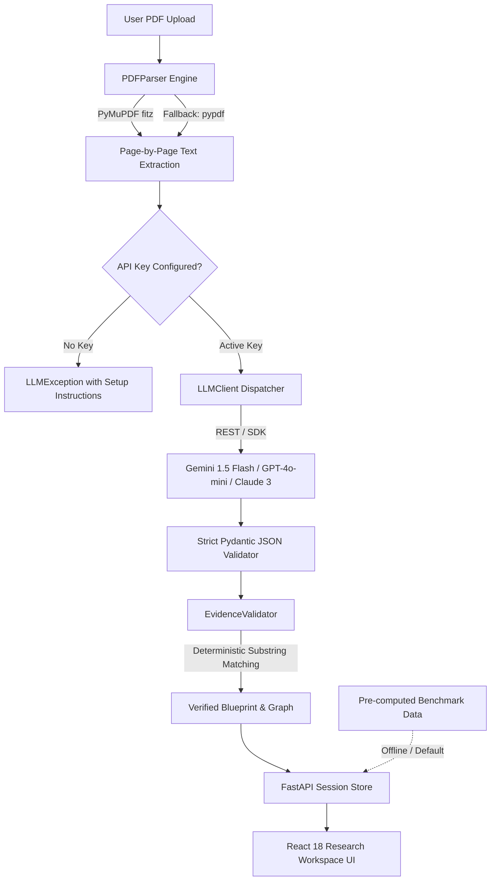

# Paper2Run — Evidence-Backed AI/ML Research-to-Reproduction Assistant

[](https://www.python.org/)
[](https://fastapi.tiangolo.com/)
[](https://react.dev/)
[](https://www.typescriptlang.org/)
[](https://vitejs.dev/)
[](LICENSE)

> **Tagline:** Understand the paper. Connect the evidence. Reproduce the experiment.  
> **Product Category:** Evidence-backed AI/ML research-to-reproduction assistant  
> **Target Audience:** Graduate students, ML research interns, AI engineers, and developers looking to inspect, understand, and reproduce empirical machine learning papers without guesswork, hallucinated defaults, or hidden blind spots.

---

## Table of Contents

1. [What is Paper2Run?](#-what-is-paper2run)
2. [Research Integrity & Core Tenets](#-research-integrity--core-tenets)
3. [Required APIs & Provider Guide](#-required-apis--provider-guide)
4. [Interactive UI/UX Workspace Tour](#-interactive-uiux-workspace-tour)
5. [System Architecture & Data Flow](#-system-architecture--data-flow)
6. [Quickstart & Installation Guide](#-quickstart--installation-guide)
7. [Comprehensive REST API Reference](#-comprehensive-rest-api-reference)
8. [Testing & Quality Assurance](#-testing--quality-assurance)
9. [Project Directory Layout](#-project-directory-layout)
10. [Security & Privacy](#-security--privacy)
11. [Citation & Credits](#-citation--credits)

---

## 🌟 What is Paper2Run?

**Paper2Run** is a research workspace designed to bridge the gap between reading an academic AI/ML PDF and constructing a defensible, reproducible codebase.

Traditional AI paper tools act as generic chat bots that summarize text without accountability. When asked for training hyperparameters, generic LLMs often hallucinate common library defaults (e.g., guessing Adam learning rate $\alpha = 10^{-3}$, batch size $32$, or seed $42$) even when the authors never reported them.

Paper2Run fundamentally rejects this paradigm through an evidence-first pipeline:

$$\text{Uploaded PDF} \longrightarrow \text{Verbatim Evidence Extraction} \longrightarrow \text{Connected Blueprint} \longrightarrow \text{3-Tier Learning} \longrightarrow \text{Gap Investigation} \longrightarrow \text{Reproducible Exports}$$

---

## ⚖️ Research Integrity & Core Tenets

Paper2Run adheres strictly to five scientific principles:

1. **Evidence Before Confidence:** Every extracted hyperparameter, architecture choice, or dataset metric is explicitly anchored to its exact page number, section heading, and verbatim document quote.
2. **Deterministic Quote Verification:** The backend algorithm searches the raw document string space using case-insensitive normalized substring indexing. If an LLM cites a sentence that does not exist word-for-word in the document, the badge is flagged as `Quote Mismatch` and the status drops to `Needs Review`.
3. **Explicit Uncertainty Handling:** Any parameter omitted or ambiguously described in the paper remains visibly flagged as `UNKNOWN` / `not_found`. Paper2Run never silently injects defaults.
4. **Suggestions Labeled Transparently:** When Paper2Run suggests an empirical default for an omitted setting, it is branded in purple as a **SUGGESTION** with scientific rationale and citations to open-source reproduction repositories (e.g., Hugging Face Transformers or PyTorch Lightning). It is never disguised as author-reported data.
5. **Honest Reproduction Boundaries:** Completing all checklist items does not guarantee bit-exact numerical reproduction. Hardware differences (A100 vs H100 tensor core accumulation), non-deterministic CUDA operations, seed variance, and software version discrepancies can cause divergence. Paper2Run makes these experimental realities transparent.

---

## 🔑 Required APIs & Provider Guide

Paper2Run operates in two distinct modes:

| Mode | API Key Required? | Description |
| :--- | :---: | :--- |
| **Benchmark Mode** | ❌ No | Fully functional out-of-the-box. Ships with two comprehensive, pre-computed benchmark papers: **Vaswani et al. (2017) Transformer** and **Hu et al. (2021) LoRA**. All graphs, 3-tier explanations, prerequisites, and exports work offline. |
| **Live Extraction Mode** | ✅ Yes | Required when uploading a new PDF document. Performs live multi-page text parsing, structured extraction, evidence quote discovery, and relational graph construction. |

### Supported Providers & Setup Instructions

Paper2Run supports three major LLM providers. **Only ONE provider key is required** for full live functionality.

#### 1. Google Gemini (Recommended — 100% Free Tier Available)
- **Model Used:** `gemini-1.5-flash` (Fast, large 1M+ token context window, ideal for long research papers with appendices).
- **Cost:** **Free** (Google provides a generous free tier with zero credit card required).
- **How to Get Your Key:**
  1. Visit [Google AI Studio](https://aistudio.google.com/app/apikey).
  2. Sign in with any standard Google account.
  3. Click **"Create API key"** and select a Google Cloud Project (or create one automatically with one click).
  4. Copy your generated key string (starts with `AIzaSy...`).

#### 2. OpenAI
- **Models Used:** `gpt-4o-mini` (default) with automatic fallback to `gpt-3.5-turbo`.
- **Cost:** Pay-as-you-go commercial API.
- **How to Get Your Key:**
  1. Visit the [OpenAI Platform API Keys Page](https://platform.openai.com/api-keys).
  2. Log in and click **"Create new secret key"**.
  3. Copy your key string (starts with `sk-proj-...`).

#### 3. Anthropic
- **Model Used:** `claude-3-haiku-20240307` (Fast, accurate JSON synthesis).
- **Cost:** Pay-as-you-go commercial API.
- **How to Get Your Key:**
  1. Visit the [Anthropic Console](https://console.anthropic.com/settings/keys).
  2. Generate a new API key string (starts with `sk-ant-...`).

### How to Configure API Keys

You can configure your API key in either of two ways:

#### Option A: Interactive In-App Settings Modal (Zero Restart Required)
1. Launch the application.
2. In the top navigation bar, click the **Settings (Gear)** icon or the **"No Key Set"** indicator.
3. Select your provider (**Google Gemini**, **OpenAI**, or **Anthropic**).
4. Paste your API key and click **"Save & Test Connection"**.
5. The backend immediately performs a live handshake ping and activates the provider across your session.

#### Option B: Environment Variable (`.env`) File
Create a `.env` file in the project root (or inside `backend/`):
```ini
# Choose one or more:
GEMINI_API_KEY=AIzaSy...your_gemini_key_here
OPENAI_API_KEY=sk-proj-...your_openai_key_here
ANTHROPIC_API_KEY=sk-ant-...your_anthropic_key_here

# Provider preference: auto | gemini | openai | anthropic
LLM_PROVIDER=auto
```

---

## 🖥️ Interactive UI/UX Workspace Tour

Paper2Run provides a high-density, glassmorphic research environment designed for rigorous analysis:

```
┌───────────────────────────────────────────────────────────────────────────────┐
│ [Paper2Run]  [Transformer ▾]  [Live Key: Gemini ✓]  [Export ▾]  [Upload PDF]   │
├───────────────────────────────────────────────────────────────────────────────┤
│ PAPER HEADER: Attention Is All You Need (12 pgs) | 11/14 Reported | 3 Gaps   │
├───────────────────────────────┬───────────────────────────────────────────────┤
│ EXECUTIVE RESEARCH OVERVIEW   │ RESEARCH TOPOLOGY GRAPH (Interactive SVG)     │
│ • Problem & Motivation        │  [Objective] ──> [Architecture] ──> [Optimizer]│
│ • Proposed Architecture       │  Curved Bezier connectors & Click-to-Focus    │
│ • Key Empirical Results       ├───────────────────────────────────────────────┤
│ • Documented Limitations      │ 3-TIER MULTI-LEVEL LEARNING PANEL             │
├───────────────────────────────┤  🎓 Beginner Analogy                          │
│ STRUCTURED EXPERIMENT BLUEPRINT│  ⚙️ Technical Convergence & Mechanism        │
│ • Dataset (WMT 2014 En-De)    │  📐 Mathematical Formulation & Derivations    │
│ • Architecture (d_model=512)  ├───────────────────────────────────────────────┤
│ • Optimizer (Adam β2=0.98)    │ REPRODUCTION GAPS & VERIFICATION              │
│ • Learning Rate Schedule      │  • Warmup steps ambiguity                     │
│ [Learn]  [Proof (Quotes)]     │  • Community candidate suggestions & checklist│
└───────────────────────────────┴───────────────────────────────────────────────┘
```

### 1. Executive Research Overview
Five structured synthesis cards dissecting the foundation of the paper:
- **Research Problem:** Explicit mathematical and empirical bottleneck addressed.
- **Motivation & Proposed Method:** Why prior methods (e.g. sequential RNNs) failed and how self-attention resolves it.
- **Main Architecture:** Key structural components ($d_{\text{model}}=512$, $h=8$ heads, $d_{\text{ff}}=2048$).
- **Main Results:** Validated benchmarks (BLEU scores on WMT 2014 En-De and En-Fr).
- **Limitations & Open Questions:** Compute requirements, quadratic complexity $O(n^2)$, and hardware bottlenecks.

### 2. Structured Experiment Blueprint
A categorized parameter grid covering:
- **Categories:** `dataset`, `model_architecture`, `optimizer`, `learning_rate_schedule`, `loss`, `training_setup`, and `evaluation`.
- **Status Badges:**
  - 🟢 `Reported`: Explicitly stated in the document with confirmed verbatim quotes.
  - 🟡 `Ambiguous`: Mentioned, but with conflicting statements or unclear scopes.
  - 🔴 `Not Found`: Omitted entirely from the examined text.
  - 🟣 `Suggested`: Expert recommended candidate value with external attribution.
- **Actions:**
  - **Learn:** Opens the parameter in the 3-Tier Learning Panel.
  - **Proof:** Opens the Verbatim Evidence Modal displaying the exact excerpt on the original page.

### 3. Verbatim Evidence Modal
- Displays the exact quote, section heading, and 0-indexed page number.
- Shows real-time quote validation (`Quote Verified in Source Document` vs `Quote Mismatch`).
- **One-Click Citation Copy:** Copies a formatted BibTeX/academic markdown quote block to clipboard with one click.

### 4. Interactive Research Connection Topology
- Full SVG-based interactive canvas rendering directional Bezier curves.
- **Semantic Relationship Types:**
  - `Objective` $\xrightarrow{\text{motivates}}$ `Method`
  - `Method` $\xrightarrow{\text{uses}}$ `Architecture`
  - `Architecture` $\xrightarrow{\text{trained on}}$ `Dataset`
  - `Dataset` $\xrightarrow{\text{optimized with}}$ `Optimizer`
  - `Optimizer` $\xrightarrow{\text{blocked by}}$ `Reproduction Gap`
- **Dynamic Node Selection:** Clicking any node highlights connected inbound and outbound paths while dimming unrelated elements.
- **Entity Navigator:** Side rail listing all entities with categorical color codes and provenance tags (`Explicit` vs `Inferred`).

### 5. 3-Tier Pedagogical Learning Panel
Deep dive into any concept without leaving the workspace:
- 🎓 **Beginner Level:** Real-world analogies, intuitive explanations, and mental models.
- ⚙️ **Technical Intuition:** Engineering trade-offs, convergence dynamics, gradient behavior, and practical failure modes.
- 📐 **Mathematical Deep Dive:** Rigorous equations, variance analysis (e.g., why dot products are divided by $\sqrt{d_k}$), and parameter derivations.
- **Transparency Notice:** Explicitly discloses which portions are verbatim citations from the authors versus contextual background knowledge.

### 6. Interactive Prerequisites Roadmap
- Dynamic dependency tree rendered below the learning panel.
- Tracks mastery of foundational ML concepts required before executing the paper (e.g., *Matrix Multiplication*, *Softmax & Attention*, *Layer Normalization*, *Adam Optimizer Mechanics*).
- Interactive completion checkboxes allow researchers to track their preparation.

### 7. Verification & Reproduction Gaps Inspector
- Contextual investigation panel for missing or ambiguous hyperparameters.
- Explains **why** the gap threatens reproduction (e.g., non-standard Adam $\beta_2 = 0.98$ instead of the standard library default $0.999$, which can cause divergence if misconfigured).
- Provides recommended candidate settings with scientific justifications and links to verified community implementations.

### 8. Multi-Format Export Studio
Generate clean reproduction assets in four formats:
- **Markdown Report (`.md`):** Complete evidence-backed reproduction briefing.
- **Strict JSON Blueprint (`.json`):** Machine-readable configuration maintaining explicit `null` for omitted parameters.
- **YAML Blueprint (`.yaml`):** Human-readable configuration file ready for PyTorch/Hydra training scripts.
- **Reproduction Checklist (`.md`):** Phase-by-phase actionable checklist (Environment, Data Preprocessing, Architecture Verification, Training, Evaluation).

---

## 🏛️ System Architecture & Data Flow



### PDF Parser Fault Tolerance
In secure OS environments (such as Windows Defender Application Control policies that block unsigned binary C-extensions like `_mupdf.pyd`), Paper2Run's `PDFParser` automatically detects the block and falls back to pure-Python `pypdf`, guaranteeing zero crashes and 100% extraction uptime.

---

## 🚀 Quickstart & Installation Guide

### Prerequisites
- **Python:** Version 3.10, 3.11, or 3.12
- **Node.js:** Version 18 or higher (with `npm`)

### Option 1: Single-Click Launcher (Recommended)

From the project root:

**On Windows:**
```cmd
start.bat
```
or run with Python:
```bash
python run.py
```
This script checks dependencies, sets up local ports, starts the FastAPI backend on port `8000`, launches the Vite frontend on port `5173`, and opens your browser.

---

### Option 2: Step-by-Step Manual Setup

#### Step 1: Clone the Repository
```bash
git clone https://github.com/mysterious03/Paper2Run.git
cd Paper2Run
```

#### Step 2: Backend Setup
```bash
# Navigate to backend folder
cd backend

# Create and activate virtual environment (optional but recommended)
python -m venv venv
# On Windows:
venv\Scripts\activate
# On Linux/macOS:
source venv/bin/activate

# Install dependencies
pip install -r requirements.txt

# (Optional) Copy environment template
copy ..\.env.example .env

# Start FastAPI server
python -m uvicorn app.main:app --host 127.0.0.1 --port 8000 --reload
```
FastAPI interactive documentation is now live at: [http://127.0.0.1:8000/docs](http://127.0.0.1:8000/docs).

#### Step 3: Frontend Setup
In a new terminal window:
```bash
# Navigate to frontend folder
cd frontend

# Install npm packages
npm install

# Start Vite development server
npm run dev -- --host 127.0.0.1 --port 5173
```
Open your browser at: **`http://127.0.0.1:5173`**.

---

## 📡 Comprehensive REST API Reference

All backend endpoints are prefixed with `/api`.

### Settings & Provider Management

#### `GET /api/settings/keys`
Returns the configuration status and masked strings of all supported providers.
```json
{
  "gemini_configured": true,
  "gemini_masked": "AIza...9xKl",
  "openai_configured": false,
  "openai_masked": "",
  "anthropic_configured": false,
  "anthropic_masked": "",
  "active_provider": "Google Gemini"
}
```

#### `POST /api/settings/keys`
Updates an API key dynamically at runtime and tests connection.
- **Request Body:**
  ```json
  {
    "provider": "gemini",
    "key": "AIzaSy..."
  }
  ```
- **Response:**
  ```json
  {
    "success": true,
    "message": "Successfully connected to Google Gemini!",
    "active_provider": "Google Gemini"
  }
  ```

#### `POST /api/settings/test`
Runs a live round-trip test with the currently active LLM provider.

---

### Document Ingestion & Analysis

#### `GET /api/sample/list`
Lists available pre-computed benchmark papers for exploration.
```json
[
  {
    "id": "transformer",
    "paper_id": "sample_transformer_2017",
    "title": "Attention Is All You Need (Vaswani et al., 2017)",
    "domain": "Sequence Transduction / Transformer",
    "gaps": 3
  },
  {
    "id": "lora",
    "paper_id": "sample_lora_2021",
    "title": "LoRA: Low-Rank Adaptation (Hu et al., 2021)",
    "domain": "Parameter-Efficient Fine-Tuning (PEFT)",
    "gaps": 2
  }
]
```

#### `GET /api/sample?paper={transformer|lora}`
Retrieves the complete benchmark analysis object for the selected paper.

#### `POST /api/papers`
Uploads a research PDF document. Automatically parses text and triggers the evidence-backed extraction pipeline.
- **Content-Type:** `multipart/form-data`
- **Form Field:** `file` (Binary PDF data)
- **Response:** Complete `AnalysisResult` JSON object containing `metadata`, `overview`, `blueprint`, `graph`, and `gaps`.

#### `GET /api/papers/{paper_id}`
Returns the stored analysis result for a given paper ID.

#### `GET /api/papers/{paper_id}/blueprint`
Returns the array of `BlueprintField` items for the paper.

#### `GET /api/papers/{paper_id}/graph`
Returns the `ResearchGraph` object containing relational nodes and directional edges.

---

### Learning & Gap Analysis

#### `POST /api/papers/{paper_id}/explain`
Generates a multi-tier pedagogical explanation for any specific parameter field or architecture node.
- **Request Body:**
  ```json
  {
    "field_id": "field_optimizer",
    "level": "technical"
  }
  ```
- **Supported Levels:** `"beginner"`, `"technical"`, `"math"`
- **Response:** `LearningExplanation` object including intuition, equations, warnings, and author vs background citations.

#### `GET /api/papers/{paper_id}/gaps`
Returns all detected reproduction gaps, missing parameters, and candidate community recommendations.

---

### Blueprint Exporting

#### `GET /api/papers/{paper_id}/export?format={markdown|json|yaml|checklist}`
Downloads the reproduction blueprint in the requested format.
- `format=markdown`: Full research reproduction report (`.md`).
- `format=json`: Machine-readable schema retaining `null` for unknown parameters (`.json`).
- `format=yaml`: YAML configuration for experiment setup (`.yaml`).
- `format=checklist`: Step-by-step reproduction readiness checklist (`.md`).

---

## 🧪 Testing & Quality Assurance

Paper2Run includes comprehensive test suites covering unit algorithms, schema validation, PDF parsers, and live API endpoints.

### Run Backend Unit & Integration Tests
```bash
cd backend
python -m pytest tests/ -v
```
**Test Coverage Includes:**
- `test_quote_matching_exact`: Verifies exact substring location finding.
- `test_quote_mismatch_detection`: Verifies status drops to `needs_review` on tampered quotes.
- `test_pydantic_validation`: Validates strict schema adherence.
- `test_3tier_learning_levels`: Tests pedagogical response structures.
- `test_export_service_all_formats`: Tests Markdown, JSON, YAML, and Checklist generation.
- `test_pdf_parser_real_file`: Tests real PDF parsing and scanned document detection.

### Run Live Server Test
With the backend server running:
```bash
python backend/tests/test_live_server.py
```

### Validate Frontend Production Build
```bash
cd frontend
npm run build
```

---

## 📂 Project Directory Layout

```
Paper2Run/
├── .env.example                  # Environment variable configuration template
├── README.md                     # Comprehensive technical documentation
├── run.py                        # Unified one-click runner script
├── start.bat                     # Windows batch launcher
│
├── backend/                      # FastAPI Python Backend
│   ├── requirements.txt          # Python dependencies
│   ├── app/
│   │   ├── main.py               # FastAPI application routes & middleware
│   │   ├── config.py             # Settings & environment configuration
│   │   ├── schemas/
│   │   │   └── models.py         # Pydantic V2 data models & schemas
│   │   └── services/
│   │       ├── pdf_parser.py     # Resilient PyMuPDF & PyPDF text parser
│   │       ├── evidence_validation.py # Deterministic quote verifier
│   │       ├── extraction.py     # Live LLM extraction engine
│   │       ├── learning.py       # 3-tier pedagogical explanation engine
│   │       ├── export_service.py # Markdown, JSON, YAML, Checklist generator
│   │       ├── llm_client.py     # Multi-provider client (Gemini, OpenAI, Anthropic)
│   │       └── sample_data.py    # Vaswani (Transformer) & Hu (LoRA) benchmarks
│   └── tests/                    # Pytest test suite
│       ├── test_core.py          # Evidence validation & export unit tests
│       ├── test_pdf_integration.py # Real PDF parsing tests
│       └── test_live_server.py   # Live server end-to-end integration test
│
└── frontend/                     # React 18 + Vite + TypeScript Frontend
    ├── package.json              # Frontend dependencies & scripts
    ├── vite.config.ts            # Vite build configuration
    └── src/
        ├── App.tsx               # Main research workspace layout
        ├── index.css             # Glassmorphic research design system & tokens
        ├── types/                # TypeScript type definitions
        ├── services/
        │   └── api.ts            # Typed Axios API client
        └── components/
            ├── Navbar.tsx        # Benchmark switcher, export menu, key modal trigger
            ├── PaperHeader.tsx   # Title, readiness counters, reproduction boundaries
            ├── OverviewSection.tsx # 5 executive research synthesis cards
            ├── BlueprintSection.tsx # Structured hyperparameter & setup table
            ├── ConnectionsSection.tsx # Interactive SVG Bezier topology canvas
            ├── LearningPanel.tsx # 3-tier learning depth & prerequisites roadmap
            ├── VerificationPanel.tsx # Reproduction gap analysis & candidate settings
            ├── EvidenceModal.tsx # Verbatim quote inspector with citation copy
            ├── SettingsModal.tsx # Live API key manager & connection tester
            └── UploadModal.tsx   # PDF drag-and-drop uploader with key guide
```

---

## 🔒 Security & Privacy

1. **Local-First Execution:** Uploaded PDF documents and parsed text are processed in memory and stored exclusively in your local `backend/uploads/` directory. No document is shared with third parties other than the specific LLM API endpoint you configure.
2. **API Key Safety:** Keys entered via the Settings Modal or `.env` are stored locally in server memory and session storage. Keys are never returned in plaintext in API responses (they are permanently masked as `AIza...9xKl`).
3. **No Prompt Injection Leakage:** Extracted paper text is isolated inside sanitized delimitation blocks, preventing malicious prompt injections embedded within academic PDFs from executing unintended system commands.

---

## 📜 Citation & Credits

If you use Paper2Run in your academic research or reproduction experiments, please cite:

```bibtex
@software{paper2run2026,
  author = {Paper2Run Contributors},
  title = {Paper2Run: Evidence-Backed AI/ML Research-to-Reproduction Assistant},
  year = {2026},
  url = {https://github.com/mysterious03/Paper2Run}
}
```
